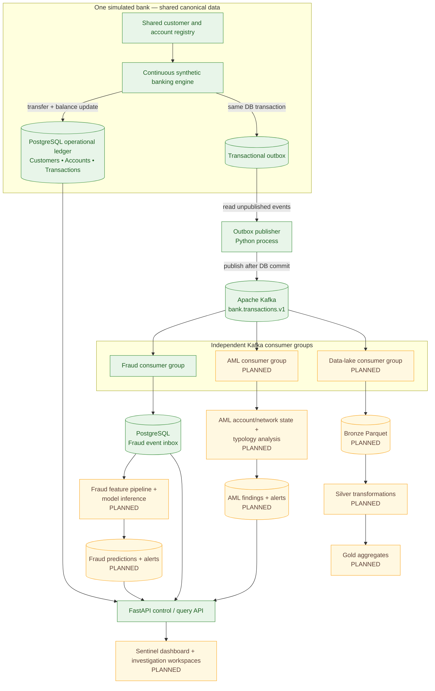
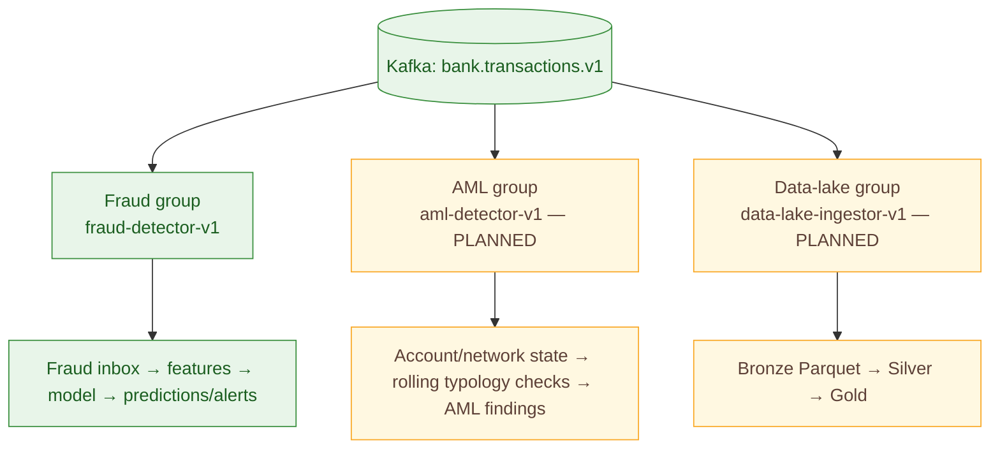

# Sentinel — High-Level Architecture and Python File Flow

**Document type:** HLD + implementation flow reference  
**Status:** Current implementation mapped; future components explicitly marked as planned  
**Project:** Sentinel — Unified Banking Fraud Detection and Anti-Money Laundering Investigation System

This document answers two questions:

1. **HLD:** What are the major system components and how do they connect?
2. **Code/process flow:** When an event moves from one component to the next, which Python file is responsible, and what happens there?

> **Accuracy rule:** Solid/current sections describe files and behavior already implemented in the repository as of Task 10. Components marked **PLANNED** are part of the approved target architecture but must not be treated as implemented.

---

## 1. System purpose

Sentinel is a downstream intelligence and investigation system for one simulated bank. The same canonical customers, accounts and transaction ledger are shared by the fraud and AML pipelines.

- The synthetic banking engine creates simulated transactions.
- PostgreSQL stores the canonical banking records and transactional outbox.
- The outbox publisher sends committed events to Kafka.
- Independent Kafka consumer groups process the same event stream for fraud, AML and data-lake use cases.
- Fraud and AML findings are stored separately and presented through investigation workspaces.

Sentinel does not authorize, settle, or block real payments.

## 2. HLD — High-level system architecture

The following diagram shows the approved target architecture. It includes both implemented components and planned downstream components.

**Diagram legend:** Green = implemented by the current project stage; yellow = planned target component. The diagram is a system-level view, not a claim that every arrow is already running in the application.

### 2.1 Main component responsibilities

| Component | Responsibility | Current status |
|---|---|---|
| Shared registry | Canonical customer and account identities for the simulated bank | Implemented |
| Synthetic banking engine | Generates transfers and updates simulated account balances | Implemented |
| PostgreSQL ledger | Stores customers, accounts and transactions | Implemented |
| Transactional outbox | Stores event intent atomically with the banking transaction | Implemented |
| Outbox publisher | Publishes pending outbox events to Kafka and records acknowledgement | Implemented |
| Kafka topic | Transports versioned transaction events | Implemented |
| Fraud consumer | Validates events and persists them in a fraud-specific inbox | Implemented |
| Fraud model and alerts | Builds features, scores events and stores predictions/alerts | Planned — next fraud pipeline work |
| AML consumer and analysis | Maintains account/network state and evaluates AML typologies | Planned |
| Data lake | Bronze, Silver and Gold analytical datasets | Planned |
| Dashboard and investigation UI | Presents ledger views, findings and cases | Planned / not covered by Tasks 1–10 |

---

## 3. End-to-end Python file flow — vertical view

This diagram follows one simulated transaction from generation through the currently implemented fraud ingestion boundary. Each process box names the actual Python entry point or implementation file.

```mermaid
flowchart TD
    A["1. FastAPI control API<br/><b>backend/app/main.py</b><br/>Receives start / pause / resume / stop requests"]
    B["2. Background banking engine<br/><b>backend/app/services/live_banking_engine.py</b><br/>Generates the next transfer"]
    C["3. Shared banking and transaction logic<br/><b>backend/app/services/registry.py</b><br/><b>backend/app/services/transaction_generator.py</b><br/>Canonical entities and synthetic transaction logic"]
    D["4. Persist transfer atomically<br/><b>backend/app/db/repository.py</b><br/>Updates balances + inserts transaction + inserts outbox event"]
    E[("5. PostgreSQL<br/><b>backend/app/db/tables.py</b><br/>transactions + outbox_events")]
    F["6. Outbox publisher process<br/><b>backend/app/publish_outbox.py</b><br/>Starts publisher loop and handles shutdown"]
    G["7. Publish pending events<br/><b>backend/app/services/outbox_publisher.py</b><br/>Reads pending rows, sends Kafka message, marks acknowledged rows"]
    H[("8. Kafka topic<br/><b>bank.transactions.v1</b><br/>Three partitions in local development")]
    I["9. Fraud consumer process<br/><b>backend/app/consume_fraud.py</b><br/>Starts and stops the fraud consumer"]
    J["10. Parse and validate event<br/><b>backend/app/models/events.py</b><br/>Strict versioned event schema"]
    K["11. Fraud ingestion logic<br/><b>backend/app/services/fraud_event_consumer.py</b><br/>Validates, deduplicates, quarantines and commits offsets after DB persistence"]
    L[("12. PostgreSQL fraud inbox<br/><b>fraud_event_inbox</b><br/>Durable record of accepted fraud-stream events")]
    M["13. Fraud feature engineering + model inference<br/><b>PLANNED — file/module not created yet</b><br/>Build approved features and score the transaction"]
    N[("14. Fraud predictions and alerts<br/><b>PLANNED — database tables not created yet</b>")]

    A --> B --> C --> D --> E
    E --> F --> G --> H --> I --> J --> K --> L --> M --> N

    classDef implemented fill:#e8f5e9,stroke:#388e3c,color:#1b5e20
    classDef planned fill:#fff8e1,stroke:#f9a825,color:#5d4037
    class A,B,C,D,E,F,G,H,I,J,K,L implemented
    class M,N planned
```

### 3.1 File-by-file responsibility

| Step | Python file | What it does |
|---:|---|---|
| 1 | `backend/app/main.py` | Exposes FastAPI health and simulation control endpoints. It does not run the continuous generation loop inside the request handler. |
| 2 | `backend/app/services/live_banking_engine.py` | Runs the background worker, controls its lifecycle and asks the repository to persist generated transfers. |
| 3a | `backend/app/services/registry.py` | Creates the shared canonical synthetic customer/account registry. |
| 3b | `backend/app/services/transaction_generator.py` | Generates synthetic transaction data and fraud/AML ground-truth metadata for controlled datasets. The live engine currently generates normal transfers; it does not inject the labelled fraud scenarios into the live stream. |
| 4 | `backend/app/db/repository.py` | Persists a live transfer with account balance updates, transaction row and outbox row in one database transaction. |
| 5 | `backend/app/db/tables.py` | Defines SQLAlchemy database table mappings, including transactions, outbox and fraud inbox/rejection tables. |
| 6 | `backend/app/publish_outbox.py` | Standalone process entry point for the outbox publisher. |
| 7 | `backend/app/services/outbox_publisher.py` | Claims pending outbox rows, publishes to Kafka, and marks an event published after broker acknowledgement. |
| 8 | Kafka topic `bank.transactions.v1` | Carries the versioned transaction-created event to independent consumer groups. Kafka is infrastructure, not a Python file. |
| 9 | `backend/app/consume_fraud.py` | Standalone process entry point for the fraud Kafka consumer. |
| 10 | `backend/app/models/events.py` | Defines and validates the strict Pydantic event schema. |
| 11 | `backend/app/services/fraud_event_consumer.py` | Processes Kafka records, stores valid events in the fraud inbox, quarantines invalid records, deduplicates event IDs and commits offsets only after durable database work. |
| 12 | PostgreSQL `fraud_event_inbox` | Stores accepted event payloads for the fraud pipeline. This is ingestion storage, not a fraud prediction. |
| 13–14 | Not created yet | Fraud feature engineering, model inference, prediction history and alert creation are future work. Do not assume these modules/tables already exist. |

---

## 4. What happens at each hand-off?

### 4.1 Banking engine → PostgreSQL

The background worker generates a transfer. The repository performs the account balance changes, inserts the transaction and inserts the corresponding outbox event as one database transaction. If the database transaction rolls back, those changes should roll back together.

### 4.2 PostgreSQL outbox → Kafka

The publisher reads unpublished outbox rows and sends each event to Kafka. It marks a row as published only after Kafka acknowledges the send. A crash after Kafka acknowledgement but before the database update can cause a duplicate publication, so downstream consumers must be idempotent.

### 4.3 Kafka → fraud consumer → PostgreSQL inbox

The fraud consumer validates the message against the versioned schema. It persists a valid event or a durable rejection record before committing the Kafka offset. If database persistence fails, it must not commit that record's offset.

### 4.4 Fraud inbox → model inference (next implementation stage)

The inbox is the boundary currently reached by Task 10. The next stage must:
1. Load the accepted event and retrieve permitted account context.
2. Build model features from an explicit allowlist.
3. Exclude event IDs, customer/account identifiers where inappropriate, fraud/AML labels, scenario names and generator-only metadata from model inputs.
4. Load a trained and versioned fraud model.
5. Persist the prediction, score/probability, model version and prediction timestamp.
6. Apply documented decision thresholds to create fraud alerts.

Model training is a separate offline process; the live consumer should not retrain the model for every transaction.

---

## 5. Independent downstream flows

Kafka delivers each retained event independently to each consumer group. These consumers do not sit one after another.

A separate group ID allows each consumer group to read its own copy of the topic stream. A slow or stopped AML consumer should not make the fraud consumer give up its partition assignments, and the data-lake consumer is not a step that fraud must pass through.

---

## 6. Evidence and current implementation boundary

As of the completion of Task 10:

- The project test suite was reported by the user as **50 passed**.
- The PostgreSQL schema update completed successfully.
- The fraud consumer connected to the local Kafka broker and joined group `fraud-detector-v1`.
- The consumer logged `Fraud event ingestion: stored`.
- A PostgreSQL query confirmed event `22290321-491b-4a52-9849-5765905276d8` for transaction `e5139fba38fc4f0dbfbc2e0a3c958a3d` in `fraud_event_inbox`.

This is evidence of one successful local outbox → Kafka → fraud consumer → PostgreSQL inbox path. It is not evidence of fraud model accuracy, production throughput, high availability, crash recovery under all failure timings, or production reliability.

---

## 7. How to keep this document accurate

Whenever a new task adds a process:
1. Add its real Python entry-point and service-module paths to the vertical flow.
2. Add its database tables or external infrastructure to the HLD.
3. Change a component from **PLANNED** to **IMPLEMENTED** only after code exists and its required tests/integration checks have passed.
4. Record the verification evidence and its limits.
5. Do not invent future filenames just to make the diagram look complete.
